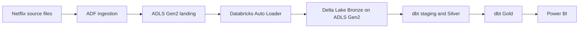

# End-to-End Data Engineering Project

**A job-ready Netflix analytics project** using Azure Data Factory, ADLS Gen2, Azure Databricks, Delta Lake, dbt Core, Power BI, and GitHub. This repository brings the implementation artifacts together so you can study how ingestion, transformation, modelling, reporting, and version control connect.

## Architecture



The Databricks notebooks include configuration and file-discovery metadata tables, schema tracking, checkpoints, and audit logging. These support **metadata-driven workflows**: dataset settings guide discovery and ingestion instead of requiring a separate notebook for each file. Delta tables store lakehouse data on ADLS Gen2; Bronze, Silver, and Gold organize it for reporting.

## Repository map

| Folder | What it contains |
| --- | --- |
| [`adf/`](adf/) | Factory JSON, linked services, datasets, master ingestion pipeline, full and incremental copy examples |
| [`databricks/Netflix_End_to_End/`](databricks/Netflix_End_to_End/) | Configuration, file discovery, Bronze Auto Loader ingestion, and enhancement notebooks |
| [`dbt/`](dbt/) | Source definitions, staging views, Silver dimensions and facts, Gold reporting models, and surrogate-key macro |
| [`powerbi/`](powerbi/) | Netflix Analytics Dashboard report and semantic model definitions |
| [`docs/`](docs/) | Supporting documentation folder |

## Follow the project

1. **Understand the use case.** Define the reporting goal, source datasets, dimensions, facts, and grain.
2. **Ingest with ADF.** Review `adf/pipeline/PL_NETFLIX_INGEST_MASTER.json` alongside the full-copy and incremental-copy pipelines. Configure linked services, datasets, parameters, and watermark settings for your environment.
3. **Prepare the lakehouse.** Run `databricks/Netflix_End_to_End/00_configurations.ipynb` after reviewing its Unity Catalog, external-location, volume, and ADLS paths.
4. **Discover and load files.** Use `01_discover_unknown_files.ipynb` followed by `02_bronze_autoloader_ingestion.ipynb`. Auto Loader reads CSV files into Bronze Delta tables with schema and checkpoint locations. `04_Enhancements.ipynb` contains further audit and ingestion logic.
5. **Model with dbt Core.** Review `dbt/models/sources/source.yml`, then build staging, Silver, and Gold models. Silver includes dimensions and facts; Gold contains `gold_content_performance` and `gold_data_quality_summary`.
6. **Report with Power BI.** Open the report and semantic model in `powerbi/` and point their data connection at your environment.
7. **Work through GitHub.** Keep ADF, Databricks, dbt, and Power BI changes together in this repository; use feature branches and pull requests to review changes.

## Run it in your environment

You need Azure Data Factory, ADLS Gen2, an Azure Databricks workspace with Unity Catalog and storage permissions, dbt Core with the Databricks adapter, and a compatible Power BI/Fabric environment. Bring your own permitted source files and credentials.

```bash
git clone https://github.com/vijaydata4u/end_end_dataengineering_project.git
cd end_end_dataengineering_project/dbt
dbt debug
dbt build
```

Before running, create a local dbt profile named `dbt_core_dataengineer`. Review catalog and schema values in `dbt/dbt_project.yml` and table names in `dbt/models/sources/source.yml`. The notebooks and ADF JSON contain environment-specific resource names and paths; replace them with your own. This repository is an implementation example, not a one-command deployment.

## Job-ready skills demonstrated

- Translate a business use case into source-to-dashboard architecture.
- Implement full and incremental ingestion with ADF.
- Use metadata and audit tables to organize repeatable ingestion workflows.
- Build Delta Lake tables on ADLS Gen2 with Auto Loader and checkpoints.
- Develop dbt sources, staging, dimensions, facts, and Gold reporting models.
- Explain data grain, Medallion layers, and Power BI consumption.
- Organize a multi-tool project in GitHub for collaborative review.

Created by **Vijay Reddy** for **VJ Tech Talks**.
